<h1 align="center">Elsewhere for Android</h1>
<p align="center"><strong>Your Google Maps Timeline, printed as a world-tour poster — natively on Android.</strong><br>
Kotlin · Jetpack Compose · the same eight tabs, the same poster, the same privacy rules as <a href="https://github.com/vsvinav/elsewhere">the web app</a>.</p>

> **Status:** under construction, usable today. All eight tabs are built — Tour, Numbers, Facts, Stops, Dates, Map, Flights and Replay; share cards and on-device recording come next. Install the latest APK from [Releases](https://github.com/vsvinav/elsewhere-android/releases).

<p align="center">
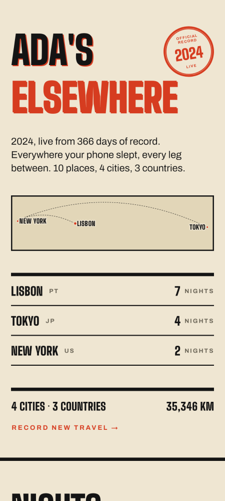
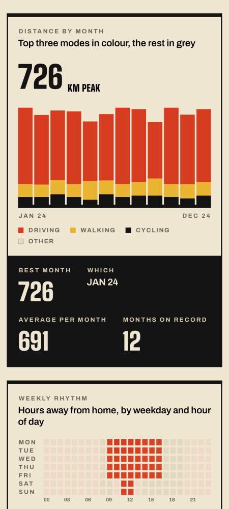
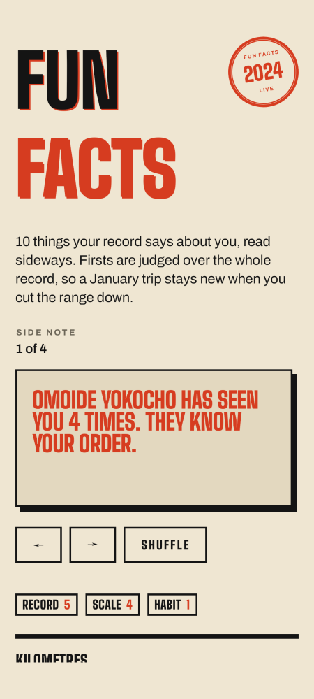
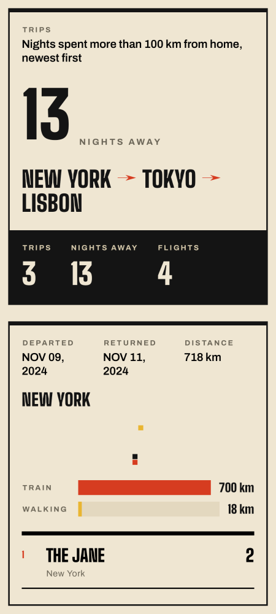
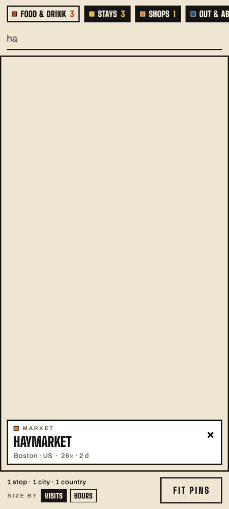
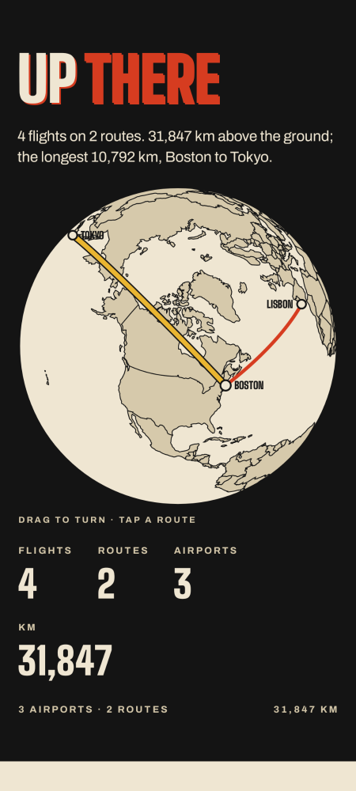
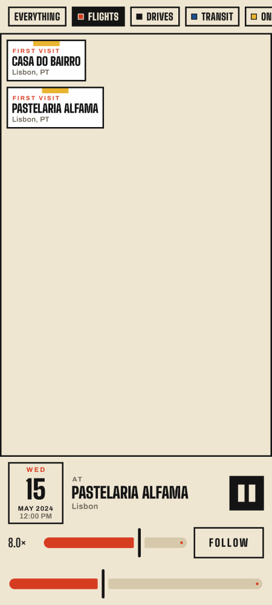
</p>

<details><summary>More screens</summary>
<p align="center">
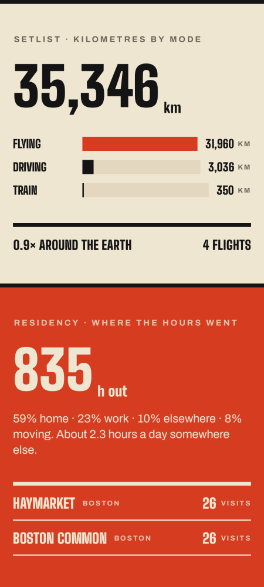
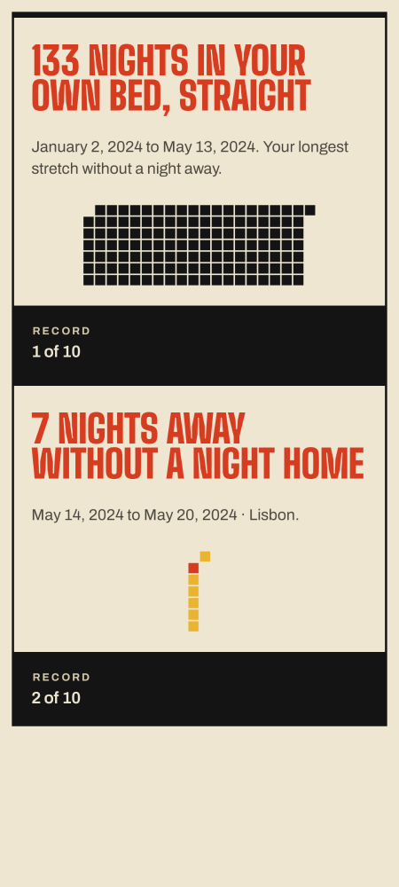
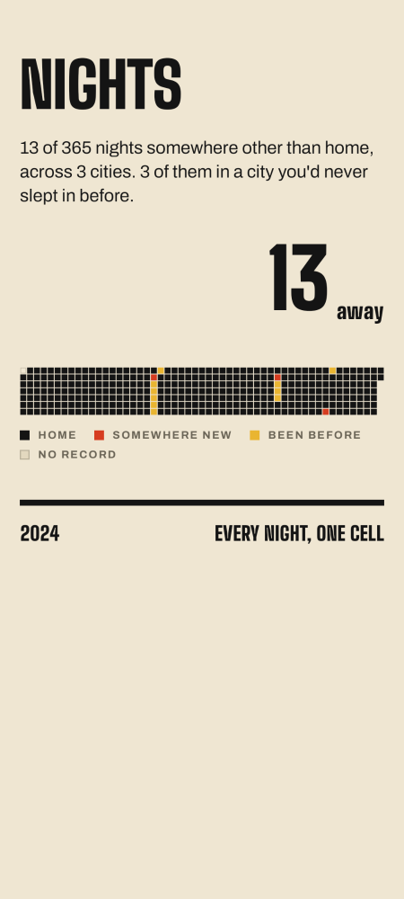
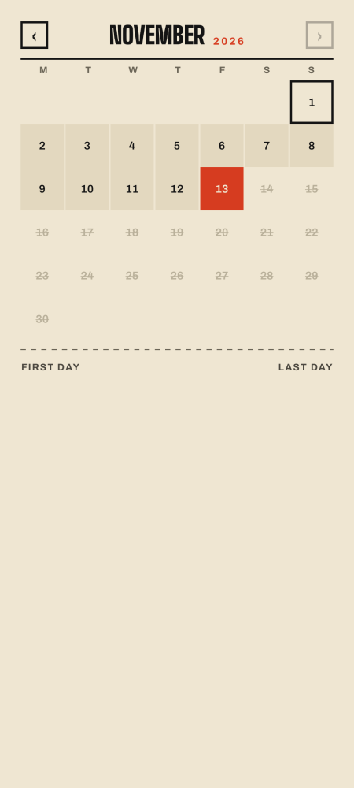

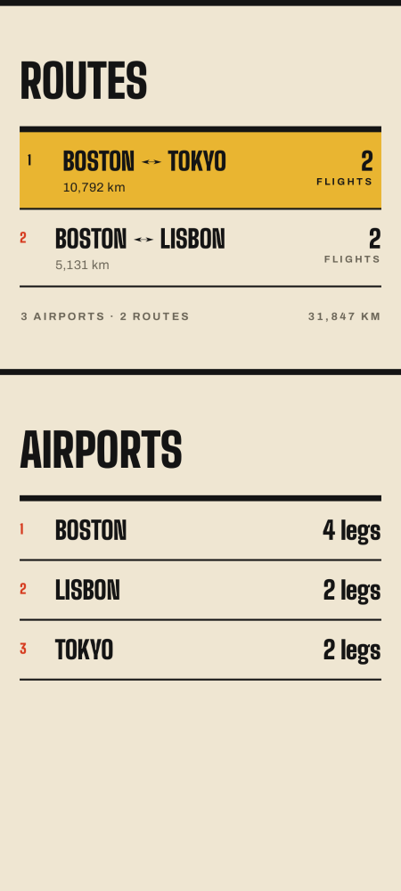
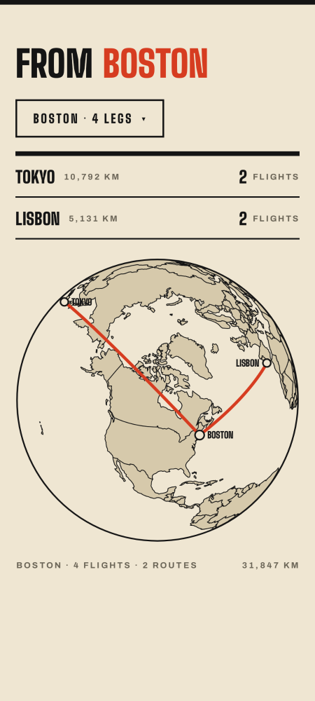
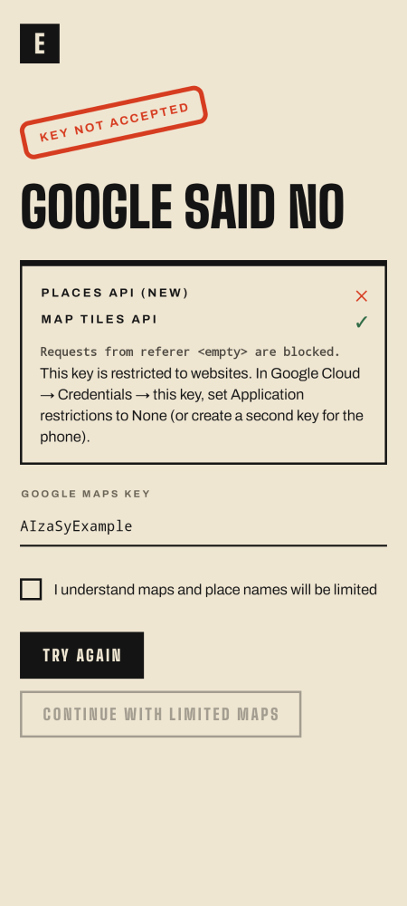
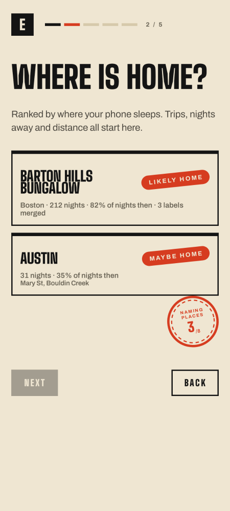

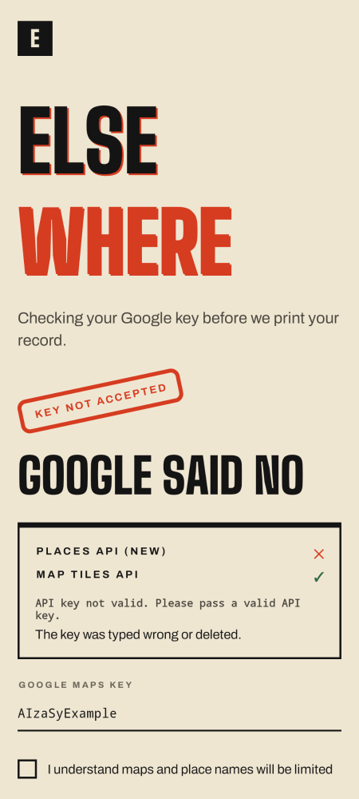
</p>
<p align="center"><sub>Rendered by the app's own screenshot tests from a synthetic record, so no real trips are shown.</sub></p>
</details>

## Progress

| Area | State |
| --- | --- |
| Timeline parser, analytics, local database | ✅ |
| Shell: ticket strip, range bar, calendar, onboarding | ✅ |
| Tour · Numbers · Facts · Stops · Dates | ✅ |
| Map (Google map tiles, OpenStreetMap fallback, clusters, search) | ✅ |
| Flights globe · From-airport bill | ✅ |
| Replay | ✅ |
| Key verification · place names and photos | ✅ |
| Lazy place lookups · readiness bar · startup key gate | ✅ |
| Share cards | ⏳ |
| Recording new location on-device | ✅ |

## What you get

| Tab | What's on it |
| --- | --- |
| **Tour** | Your years as one poster: cities ranked by nights slept, places, countries, a dotted route map. |
| **Numbers** | Distance by month and mode, best month, long-run averages. |
| **Facts** | What your record says about you, each with a figure, plus a swipeable deck of shorter, ruder ones. |
| **Stops** | The places you keep going back to, with photos and names. |
| **Dates** | A calendar of where you were, night by night. |
| **Flights** | A globe turned to show every route you've flown; tap an airport to see where it took you. |
| **Map** | Every stop pinned and clustered, filtered by category, searchable. |
| **Replay** | Press play and move through time; planes, cars, trains and walks each get their own colour. |

Pick any range — a year, 90 days, two dates — and every tab updates. Every card shares as a PNG.

## Quick start

### Install

1. Open the latest run under **Actions → Android** and download `elsewhere-debug.apk` (or grab a tagged build from **Releases**).
2. On the phone, allow installs from your browser/files app and open the APK.
3. Export your Timeline (below), open Elsewhere, pick the file.

### Export your Timeline

- **Android** — Settings → Location → Location Services → Timeline → *Export Timeline data*.
- **iPhone** — Google Maps → your photo → *Your timeline* → ⋯ → *Export*.

You get one `Timeline.json`. Google moved Timeline onto the phone in 2024; Takeout no longer includes it.

### Google Maps key (optional)

Without a key the app draws OpenStreetMap tiles and skips place names/photos. With one:

1. [console.cloud.google.com → Maps APIs](https://console.cloud.google.com/google/maps-apis), enable **Places API (New)** and **Map Tiles API**.
2. Create a key. Under *Application restrictions* choose **None** — a key restricted to websites (HTTP referrers) or to Android apps is refused, because the app calls these APIs directly over HTTPS, not through the Maps SDK. If you want to lock it down, use *API restrictions* and allow just those two APIs.
3. Paste it in the app at the front door, or later from the ▾ menu → Maps key.

The app checks the key the moment you save it, with two free requests, and shows Google's exact answer if either is refused, along with what to change. A key that fails (or no key) means *limited maps*: OpenStreetMap tiles, no place names or photos. You are asked to acknowledge that before going on, and can re-check the key from the menu any time.

The ▾ menu shows a running count of paid calls and a rough dollar figure. Names and photos are fetched once for your 100 busiest stops and cached forever.

## Build it yourself

```bash
brew install openjdk@17                                   # or any JDK 17
brew install --cask android-commandlinetools
export JAVA_HOME=/opt/homebrew/opt/openjdk@17 ANDROID_HOME=$HOME/Library/Android/sdk
sdkmanager --sdk_root=$ANDROID_HOME "platforms;android-35" "build-tools;35.0.0" "platform-tools"
git clone https://github.com/vsvinav/elsewhere-android && cd elsewhere-android
echo "sdk.dir=$ANDROID_HOME" > local.properties
./gradlew assembleDebug            # → app/build/outputs/apk/debug/app-debug.apk
./gradlew testDebugUnitTest        # JUnit twins of the web app's vitest suite
adb install -r app/build/outputs/apk/debug/app-debug.apk
```

## Recording on this phone

Google is winding down Timeline exports, so Elsewhere can keep the record itself. Open the menu (the **E**) → **Record on this phone**, or tap *Record new travel →* on the Tour hero.

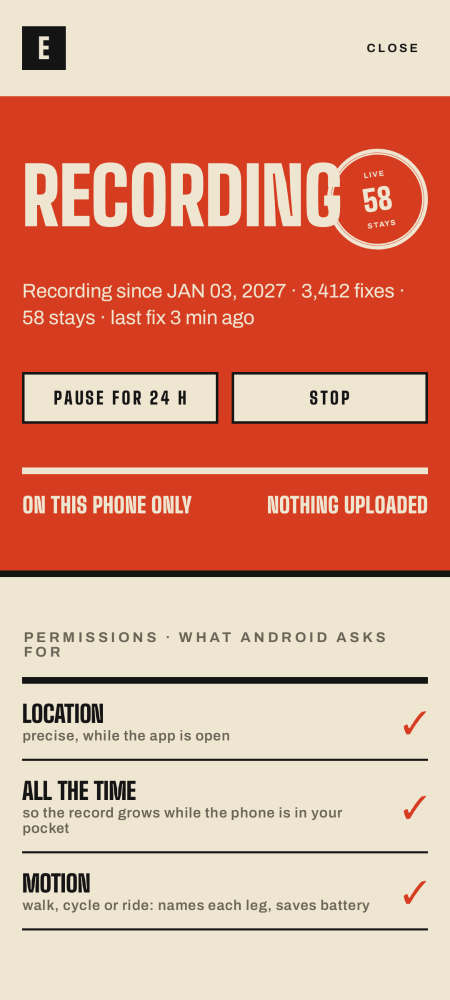

**What is collected.** A location fix roughly once a minute while you move (every five minutes while the phone is still), plus the activity-recognition hint (walking, cycling, in a vehicle). Fixes are folded on-device into the same ledger your export filled: a stay of five minutes or more within 75 m becomes a stop, the leg between two stops becomes a route with a mode and distance. Raw fixes are kept for 90 days so segmentation can be re-run; stops and routes are kept for good and survive re-imports of an export.

**What Android asks for.** Precise location, then "Allow all the time" (background location, granted from Settings), physical activity, and notifications for the persistent "Elsewhere is recording" entry. Nothing is uploaded; there is no account and no server.

**Battery.** The recorder runs as a foreground service with balanced-power location and drops to low power when the phone is still. If your phone restricts background apps, the screen offers a button to exempt Elsewhere from battery optimisation; without it some makers will kill the service and you will see gaps.

**How to stop.** The notification has a **Stop** action; the screen has **Stop** and **Pause for 24 h**. Stopping keeps what was recorded. *Start over* in the menu deletes everything, including recorded data.

## Your data

Your export never leaves the phone. It is parsed on-device and kept in a local database. Network calls: map tiles, a few free OpenStreetMap address lookups for your home picks, and — only with your key — Google Places names and photos for your hundred busiest stops.

## Layout

```
app/src/main/java/com/elsewhere/app/
├── ingest/     Timeline parser, derive (roles, places, days, trips), enrichment, cost meter
├── analytics/  range, tour, stats, facts, flights — pure Kotlin, ported 1:1 from the web app
├── data/       Room + DataStore, RecordRepository
├── map/        MapLibre host (Google tiles or free style), clustering, pins, replay camera
├── ui/world/   poster theme, fonts, Pass/Bill/Sticker/Stamp, figures
├── ui/shell/   masthead, ticket strip, range bar, calendar sheet
├── ui/tabs/    one package per tab
└── share/      card → PNG → share sheet
```

Fonts: Big Shoulders Display and Archivo, SIL Open Font License.
